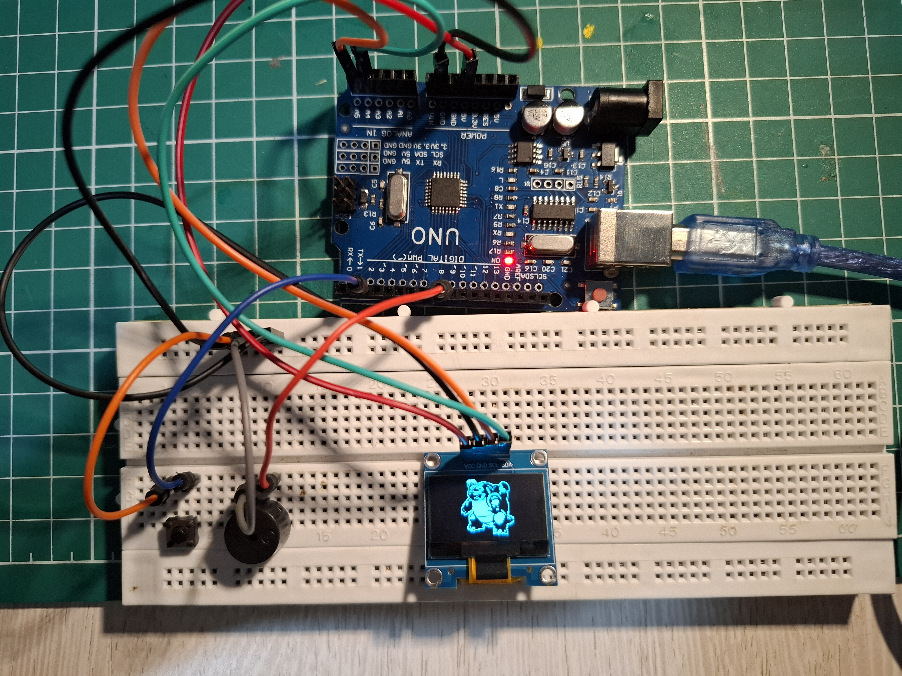

# Blastoise OLED Cry

A small Arduino project that displays a two-frame Blastoise animation on a 128×64 OLED and plays a short cry through a passive buzzer when a button is pressed.
The display should return to its standing frame when the sound finishes. The project uses an Arduino Uno, an SSD1306 I²C OLED, one push button, and a passive buzzer.

I did this project as an experiment to learn how HEX codes and displays work, along with trying to imitate noises using a simple passive buzzer.



> Fan-made project. Pokémon and Blastoise are the property of their respective owners. This project is not affiliated with or endorsed by Nintendo, The Pokémon Company, or Game Freak.

## Features

- Two-frame, 64×64 monochrome OLED animation
- Button-triggered sound effect
- Passive-buzzer sound made with Arduino's `tone()` function
- Returns to the idle frame after each cry

## Hardware

See [docs/PARTS.md](docs/PARTS.md) for the parts list and [docs/WIRING.md](docs/WIRING.md) for connections.

## Arduino libraries

Install these libraries through the Arduino IDE Library Manager:

- **Adafruit GFX Library**
- **Adafruit SSD1306**

`Wire.h` and `Arduino.h` are included with the Arduino platform.

## Project files

```text
Blastoise-OLED-Project/
├── assets/
│   ├── frame-1-reference.png
│   └── frame-2-reference.png
├── docs/
│   ├── BUILD.md
│   ├── PARTS.md
│   └── WIRING.md
├── src/
│   └── blastoise.h
├── .gitignore
├── LICENSE
└── README.md
```

Create your Arduino sketch in the Arduino IDE and save it in a sketch folder named `BlastoiseOLED`. Put `blastoise.h` in the same sketch folder as the `.ino` file (or adjust the include path if you keep the header in `src/`). Paste your final sketch into that `.ino` file.

The header defines these two bitmap arrays:

- `blastoise_bmp0` — idle/standing frame
- `blastoise_bmp1` — second/crying frame

Both are 64×64 monochrome images stored in program memory (`PROGMEM`).

## Uploading

1. Wire the components as shown in [docs/WIRING.md](docs/WIRING.md).
2. Install the two Adafruit libraries listed above.
3. Add the sketch and `blastoise.h` to the same Arduino sketch folder.
4. Select **Arduino Uno** and the correct port in the Arduino IDE.
5. Compile and upload. 

## Notes

- The button uses `INPUT_PULLUP`, so it connects between D2 and GND. No external pull-up resistor is needed.
- The buzzer is driven from D8 and GND. If your buzzer module has polarity markings, observe them.
- The OLED address in the sketch is set to `0x3C`. Some modules use `0x3D`.
- The passive buzzer can make simple electronic tones and rough effects, but it cannot reproduce a recorded creature voice.


## Assets and licensing

The MIT license in this repository applies only to original project code and documentation written for this project. It does **not** grant rights to Pokémon/Blastoise names, character designs, or the supplied bitmap artwork. Keep any artwork subject to its original rights and permissions.

If you redistribute the project publicly, make sure you have permission to share the sprite artwork you include.
